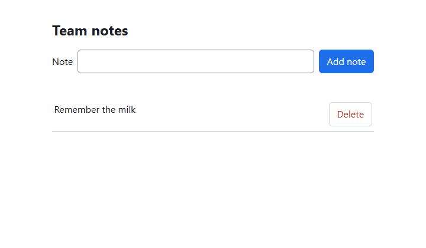

# okproof

**Your agent says it's done. okproof proves it, criterion by criterion.**

[](https://github.com/rudr19/okproof/actions/workflows/ci.yml)
[](https://github.com/rudr19/okproof/actions/workflows/codeql.yml)
[](https://scorecard.dev/viewer/?uri=github.com/rudr19/okproof)
[](https://www.npmjs.com/package/okproof)
[](LICENSE)
[](https://www.npmjs.com/package/okproof)
[](https://npm-stat.com/charts.html?package=okproof)
[](https://github.com/rudr19/okproof/releases)
[](https://github.com/rudr19/okproof)

> Browser agents act. Test frameworks run. CI reports. **okproof proves.**
> [Why okproof](WHY.md) · [Project](#project) · [Contributing](CONTRIBUTING.md) · [Security](SECURITY.md)

"Proves" is the promise; here is exactly what is checked. okproof compares a
pull request with the acceptance criteria in its issue. The criteria go in a
proof file in the repo. Tests claim criteria by tag. The run ends with a ledger
that marks each criterion **met**, **failed**, **unproven** or **untested**. A
criterion is met only when a test tagged to it passed and, as far as okproof can
tell, made a real assertion. That judgement rests on the assertion counts your
runner reports and on okproof's own static lint of the test source, which is a
heuristic (see [Weak and unrelated tests](#weak-and-unrelated-tests)): it
catches the common empty and trivial assertions, not every way to fool a test.
Untested, flaky and assertion-less tests never count. If you run the optional
verifier, a bug it finds counts only when it reproduces on a model-free replay.
okproof does not judge whether a test is a *good* test, and ledgers are not
signed (see [Project](#project)).

okproof doesn't run your tests. It works with **Playwright Test** directly, and
with **any runner that writes JUnit XML**: Jest, Vitest, pytest, JUnit,
Cypress, Go and more. It has no runtime dependencies.

## Quick start (30 seconds)

```bash
npx okproof init --agents --workflow --runner playwright
```

That one command, in your repo:

- creates `.okproof/` with an example proof file (use `--issue 142 --title "Pro upgrade"` for a real one);
- writes `.github/workflows/okproof.yml`: it runs your tests with a JUnit reporter, then `rudr19/okproof` ingests the results and gates the merge (`--runner` is one of `playwright`, `junit`, `ctrf`, `vitest`, `jest`, `pytest`). In a published release the Action is pinned to the release's full commit SHA with the version in a comment; a build that does not know its commit writes `@v0` plus a comment telling you to pin (see [Pin the Action by commit SHA](#pin-the-action-by-commit-sha));
- teaches coding agents the loop: it adds an okproof section to `AGENTS.md` and `CLAUDE.md`, copies the skill to `.claude/skills/okproof/SKILL.md`, and adds the okproof server to `.mcp.json` without touching your other servers. Everything `init` writes that runs okproof names the exact version (`npx -y okproof@<version> mcp`, `npx okproof@<version> gate`), so an agent session never runs whatever the registry serves that day.

Then edit the proof file, tag your tests with `[okproof:<id>]`, and push. The
pull request gets one okproof comment, and the check fails until every criterion
is met. `init` never overwrites a file; it prints what it skipped. Run it again
and nothing changes.

## How okproof thinks

okproof is an auditor that tries to **disprove** "done", not to confirm it.
"Done" stands only if the audit fails to knock it down. The principles (more in
[WHY.md](WHY.md)):

1. **The criterion is the unit, not the test.** Verdicts are per acceptance criterion.
2. **Silence counts against you.** Untested, flaky, assertion-less or untagged tests are not met.
3. **The auditor is never the author.** An independent verifier attacks; only model-free replay-confirmed bugs count.
4. **Graded evidence, not pass/fail.** Planned Evidence Levels: E0 claimed, E1 tagged test passed, E2 real relevant assertion, E3 survived adversarial attack (partly shipped), E4 verified in CI from the base branch with a signed ledger (roadmap, not built).
5. **Neutral across vendors.** It audits runs from any agent or runner through open JUnit and CTRF formats.

## Works with

Write JUnit XML (or CTRF JSON), then `npx okproof ingest <file>`.

| Runner | Reporter flag | Then |
| --- | --- | --- |
| Playwright | `npx playwright test --reporter=junit` (set `PLAYWRIGHT_JUNIT_OUTPUT_NAME=junit.xml`) | `npx okproof ingest junit.xml` |
| Vitest | `npx vitest run --reporter=junit --outputFile=junit.xml` | `npx okproof ingest junit.xml` |
| Jest | `npx jest --reporters=default --reporters=jest-junit` (needs `jest-junit`) | `npx okproof ingest junit.xml` |
| pytest | `python -m pytest --junitxml=junit.xml` | `npx okproof ingest junit.xml` |
| Cypress | `npx cypress run --reporter junit --reporter-options mochaFile=junit.xml` | `npx okproof ingest junit.xml` |
| Go | `gotestsum --junitfile junit.xml ./...` (needs gotestsum) | `npx okproof ingest junit.xml` |
| Anything with CTRF | a CTRF reporter writing `ctrf-report.json` | `npx okproof ingest ctrf-report.json` |

## Install

```bash
npm i -D okproof
npx okproof check
```

okproof has no runtime dependencies. The core (proof files, ledger, gate,
ingest, MCP server, Playwright reporter) runs on Node 20 or later. The browser
driver and the verifier use Node's built-in WebSocket and need Node 22 or later.

## See it in action

An agent says "All 5 acceptance criteria are implemented and tested. Done."
okproof checks the claim against the criteria in the issue:

```text
  Agent says: Done (5/5)
  okproof: 3 met · 1 failed · 1 untested — NOT PROVEN
```

Three criteria pass in a real browser. One fails, and a verifier refutation is
confirmed by replaying it with no model. One has no test at all. The gate exits
1. Run it yourself with `npm run demo` (no API key needed), or read
[the demo](examples/demo/README.md) and its
[ledger](examples/demo/out/ledger-101.md).

| Before reload | After reload |
| --- | --- |
|  |  |

## 1. Write a proof file

`.okproof/142.md`:

```md
## #142 Pro upgrade
- [ ] A member can upgrade the workspace to Pro from Billing
- [ ] Invoice preview shows a prorated amount before confirming
- [ ] A viewer (non-admin) cannot see the upgrade button
```

Run `npx okproof check` to print the tag for each criterion.

## 2. Claim criteria in test names

```ts
test('member upgrades to Pro [okproof:142.1] [okproof:142.2]', async ({ page }) => {
  // ...
});
```

**Use stable ids for anything that will live longer than one pull request.** Ids are
positional by default (`142.3` is the third line), so deleting or inserting a line above a
criterion re-points every tag below it at a different requirement, and the tests keep
passing. Give each criterion a stable id with a `{#id}` prefix, for example
`- [ ] {#sign-in} A user can sign in`, and tag tests `[okproof:142.sign-in]`. A stable id
does not move when lines are added, removed or reordered. See [docs/stable-ids.md](docs/stable-ids.md).

## 3. Build the ledger

**Playwright Test**: add the reporter.

```ts
// playwright.config.ts
export default defineConfig({
  reporter: [['list'], ['okproof/playwright']],
});
```

A test that passes only after a retry counts as flaky, which is not proven.
When Playwright records a trace, the ledger links it as evidence.

**Any other runner**: write JUnit XML, then ingest it.

```bash
npx vitest run --reporter=junit --outputFile=junit.xml
npx okproof ingest junit.xml
```

Or use CTRF (Common Test Report Format, ctrf.io). Many runners have a CTRF
reporter; ingest the JSON it writes. A test with `flaky: true` or retries that
passes is flaky, which is not proven.

```bash
npx okproof ingest ctrf-report.json
```

`ingest` picks the format from the file (`.json` is CTRF, otherwise JUnit XML).
Force it with `--format junit` or `--format ctrf`.

Both write `.okproof/ledger-<issue>.json` and `.md`. In GitHub Actions they also
write the ledger to the job summary and post it as one pull request comment
that reruns update. Give the job `pull-requests: write`, or pass
`{ github: false }` to turn this off.

## 4. Gate the merge

`npx okproof gate` exits 1 unless every criterion is met. Make it a required
check. The gate re-reads the proof files, so a stale ledger, a missing ledger or
stale verifier results fail it; the Action's `proven` output, the PR comment and
the MCP `okproof_status` verdict all use the same function.

A committed ledger is only a claim, so in CI gate from the job's own results:
`npx okproof gate --results junit.xml --require-issues 142,143` rebuilds the
ledgers in memory and ignores committed ones (the Action does this when its
`results` input is set). Do not commit `.okproof/ledger-*`. See
[docs/trust.md](docs/trust.md).

### Protect `.okproof/` with CODEOWNERS

Nothing in okproof stops an agent (or anyone with write access) from editing a
proof file to weaken a criterion. Make that a reviewed change: add a
`CODEOWNERS` entry for the folder and turn on required code-owner review.

```
# .github/CODEOWNERS
/.okproof/ @your-org/reviewers
```

Then in the repository settings (Branch protection or a ruleset for your
default branch) enable "Require a pull request before merging" and "Require
review from Code Owners", and make the okproof gate a required status check. A
pull request that touches `.okproof/*.md` now needs a human owner's approval, so
criteria cannot be silently removed or reworded by the author of the change.
Use a team or a person who is not the agent's account.

Run `npx okproof doctor` to check this setup. It is read-only: it looks at
`.github/CODEOWNERS` (does a rule cover `.okproof/` with an owner), `.gitignore`
(are ledgers ignored), your workflows (does the Action get `results`, and
`fetch-depth` when differential checks are on) and, for the repository in
`origin` or `--repo owner/name`, branch protection and rulesets through the GitHub
API (the okproof check is required, code-owner review is required). A token
(`GITHUB_TOKEN` or `GH_TOKEN`) is optional; anything it cannot read is a warning,
never a failure. It exits 1 when a check fails. `--no-network` skips GitHub.

A proof file can also demand verification. Put `{verify}` at the end of its
heading (`## #142 Pro upgrade {verify}`), or pass `--require-verify` to the gate:
then `verify-<issue>.json` must exist. Independently, a saved repro under
`.okproof/repro/<issue>.*.json` with no `verify-<issue>.json` fails the gate, so
deleting the verifier file cannot hide a refutation.

## Evidence levels

"Met" is not all the same. okproof grades the evidence behind each criterion on a
scale from E0 to E4, records it in the ledger, and lets a proof file say how much
a criterion needs.

| Level | Name | What it takes |
| --- | --- | --- |
| E0 | claimed | The criterion exists. Nothing else. (A failing tagged test, or a verifier refutation, puts a criterion back here.) |
| E1 | a tagged test passed | At least one test tagged `[okproof:<id>]` passed. |
| E2 | solid test | Every tagged test passed cleanly (no flake, no skip), at least one made a real, non-trivial assertion, and `okproof lint` does not call that test unrelated to the criterion. |
| E3 | survived adversarial verification | E2, and `okproof verify` ended `held` for the criterion, or a diff or revert file marks it `proven-by-change` or `covered` (below). |
| E4 | proven in CI | E3, produced in CI by `okproof gate --results <file>` from this job's own results, on a commit whose `.okproof/` folder is identical to the base branch's. |

**Requiring a level.** Put tokens in one `{...}` block at the start of the
criterion line, separated by spaces:

```
- [ ] {E3} Payments are charged once
- [ ] {#pay E3} Payments are charged once         (stable id "pay" and a required level)
- [ ] {#pay E3 pre} Existing payments still work  (all three)
```

| Token | Meaning |
| --- | --- |
| `#id` | A stable id (lowercase letters, digits, `-`, with at least one letter), as in [docs/stable-ids.md](docs/stable-ids.md). |
| `E0` to `E4` | The level this criterion requires. Upper case `E`, one digit. |
| `pre` | Marks a criterion that already held before the change. It has no effect on the level; `okproof diff` accepts it as `not-differential` (see "Differential proof"). |

The tokens may come in any order, each at most once (one id, one level). A block
with no recognised token, such as `{JSON} responses are valid`, is ordinary text.
Once a block has a recognised token, an unknown or malformed one (`{E5}`, `{e3}`,
`{#pay urgent}`) is an error, so a typo never silently weakens a criterion.

**Default level.** A criterion that names no level needs **E2**. Change it with
`--min-level E3` (on `ingest`, `gate`, or the Action's `min-level` input) or
`OKPROOF_MIN_LEVEL`. A line's own `{E..}` always wins, so `--min-level` raises or
lowers only the lines that name nothing. `E0` and `E1` never loosen the test
rules: a criterion is **met** only when the tests make it met (a clean pass with a
real assertion) **and** its level reaches the requirement. `{E1}` is the way to
accept a test that lint calls unrelated.

**What you see.** Ledger entries carry `level`, `required` and `gaps`. The
markdown ledger and the PR comment add a Level column with a bar as long as the
requirement, for example `E2/E3 ▰▰▱`. A criterion with passing tests but too
little evidence has the verdict `INSUFFICIENT EVIDENCE`, and the gate says exactly
what is missing:

```
#142 criterion 142.pay has E2 evidence but requires E3: survive adversarial
verification: run okproof verify until it holds for 142.pay, or add
.okproof/diff-142.json or revert-142.json marking it proven-by-change or covered.
```

The MCP `okproof_status` tool shows the same levels and a "Raise the evidence"
list with the next step for each criterion.

**Adversarial evidence (E3).** okproof reads three optional files next to the
proof file `<n>.md`:

- `verify-<n>.json`, written by `okproof verify`: a result with verdict `held`.
- `diff-<n>.json` and `revert-<n>.json`: `{"criteriaHash"?: "...", "results": [{"criterionId": "142.1", "verdict": "proven-by-change"}]}`, or `"results": {"142.1": "covered"}`. The verdicts `proven-by-change` and `covered` count. This format is provisional until the commands that write these files ship.

A file whose `criteriaHash` does not match the proof file's criteria is stale and
ignored. A malformed file supplies no evidence.

**E4 and the Action.** Only the gate can attest E4, and only for a ledger it
rebuilds in memory from `--results`; a ledger read from disk is credited with at
most E3, so committing one never counts. The GitHub Action compares `.okproof/`
with the base branch (`base-ref` input, default the pull request base) and passes
`--proof-matches-base` when it is identical; outside the Action pass the flag
yourself, or set `OKPROOF_PROOF_MATCHES_BASE=1`. Because the whole folder must
match, a pull request that adds or edits proof or verifier files cannot reach E4:
land them first, then later pull requests can. A ledger written before evidence
levels counts as E2.

Limits: levels are only as good as their inputs. E2 trusts the runner's assertion
counts and lint's heuristics, E3 trusts committed `verify`, `diff` and `revert`
files (CODEOWNERS protects them, see above), and with `--lint` a test it flags as
unrelated now holds its criterion at E1, which fails the default E2 until the test
is fixed or the line says `{E1}`.

## Weak and unrelated tests

A tag is a claim; an assertion is evidence. A tagged test that passes but makes
zero assertions proves nothing, so okproof will not call its criterion met.
Silence is not proof.

A criterion gets one of four verdicts:

- `failed`: any claiming test failed, was flaky, skipped or timed out.
- `unproven` (shown as "UNPROVEN (no assertions)"): the claiming tests passed, but every one of them is weak. The ledger lists the weak test titles.
- `met`: all claiming tests passed and at least one made a real assertion.
- `untested`: no test claims it.

A test is weak when its assertion count is exactly `0`. On the command line an
unknown count (the runner did not say) is not weak, so runners without counts
keep working. Pass `--strict-assertions` (or set `OKPROOF_STRICT_ASSERTIONS=1`) to
`okproof ingest`, or `strictAssertions: true` to the reporter, to treat unknown as
weak. The GitHub Action does this by default (`strict-assertions: false` relaxes
it); with lint on, a real assertion lint finds in the test source replaces an
unknown count, so node:test, Vitest and Jest users are not punished.

How each runner reports counts:

- **Playwright reporter**: counts `expect` steps in the result's step tree, nested ones and `expect.soft` included. A result with no step list is unknown.
- **JUnit**: the `assertions="N"` attribute on `<testcase>` (PHPUnit style). Absent means unknown. A testcase that passed only after a retry is `flaky`, so never met: `<flakyFailure>`/`<flakyError>` (Maven Surefire), `<rerunFailure>`/`<rerunError>`, or a `rerun`/`reruns`/`rerun_count` property that is not `0`.
- **CTRF**: `extra.assertions` on a test, when it is a number. Otherwise unknown.

A confirmed verifier refutation still makes a criterion `failed`.

### `okproof lint`

A static check that needs no test run:

```bash
npx okproof lint                       # scan the working directory
npx okproof lint --tests tests/ui      # limit to a path, file or glob such as "tests/**/*.spec.ts"
```

It finds tests whose title has `[okproof:<id>]` and reports the ones with no
assertion in the body (`expect(`, `assert`, `.should(`, `t.Error`, `t.Fatal`,
`require.`, `toBe`, `toEqual`, `toHave`, ...), or whose only assertions are
trivial: `expect(true).toBe(true)`, `expect(1).toBe(1)`, `expect(true).toBeTruthy()`,
`assert.ok(true)`, `assert.equal(1, 1)`, `assert True`, `assert 1 == 1`,
`self.assertTrue(True)` and the like. It also treats as not asserting anything:
constant-only comparisons (`expect(2 + 2).toBe(4)`, `assert 2 + 2 == 4`),
`toBeDefined()`, `toBeTruthy()` or `not.toBeNull()` on a fixture such as `page`,
`browser`, `context`, `driver` or `app` (also `!!page`), `expect.assertions(0)`,
assertions only inside `if (false)` or after a `return`, only inside a local
function the test never calls, or only inside a `try { } catch { }` that swallows
the failure. One real assertion next to a trivial one is enough to pass this
check. A test that claims more criteria than `--max-claims` (default 3) is
reported `OVERCLAIM`: advisory, and a failure with `--strict-relevance`. It also reports tags naming a
criterion that no proof file lists, and criteria no tagged test claims. It
exits 1 on a weak test or a dangling tag. Untested criteria are listed but do
not fail the run. Also available as `lintTests()` and the `okproof_lint` MCP tool.

It scans `*.test.*`, `*.spec.*`, `*.e2e.*`, `test_*.py`, `*_test.py` and
`*_test.go`, skipping `node_modules`, `dist` and `.git`, files over 1 MB and
anything past 5000 files. It is a heuristic with no parser: it follows
brackets while skipping strings, comments and regex literals (JS, TS, Go) or
reads the indented block (Python). Put the tag in the test title. A test
that only calls a helper which asserts is reported weak, and a tag in a comment
above a test is not followed. Treat a hit as a prompt to look, not a verdict.
The ledger counts from your runner are the authority.

Some runners report no assertion counts at all (JUnit from `node --test`, for
example), so a test with no assertion would be marked met. Feed lint into the
ledger to close that gap:

```bash
npx okproof ingest junit.xml --lint            # scan every test file under the working directory
npx okproof ingest junit.xml --lint tests/ui   # or a path or glob (`--lint=<path>` also works)
npx okproof gate --results junit.xml --lint
```

A test lint finds weak (no assertion, or only trivial ones) is counted as having
asserted nothing, so its criterion is `unproven`. Lint findings are matched to
results by the `[okproof:<id>]` tag plus the test title. A count your runner
does report stands, except for tests lint calls trivial. A test lint calls
unrelated does not fail ingest, but it keeps its criterion at evidence level E1,
which fails the default E2 (see [Evidence levels](#evidence-levels)); add
`--strict-relevance` to make ingest and the gate fail outright. After a bare `--lint`, a
following word is read as the path; write `--lint=` to put the proof folder
after it. `gate --lint` needs `--results`.

#### Possibly unrelated tests

A tag is a claim, and an agent optimising for a green gate can tag a test that
checks something else. For every tagged test that does assert, lint compares the
claimed criterion with the test body and reports:

```
possibly unrelated: test 'login works' claims 5.1 ('A user can reset their password by email') but never mentions password, email, reset
```

`okproof lint` itself only prints warnings and exits 0 (when its findings feed a
ledger with `--lint`, an unrelated test caps its criterion at E1; see
[Evidence levels](#evidence-levels)). Add `--strict-relevance`
(`strictRelevance: true` for `lintTests()` and the MCP tool) to make each one a
failure (exit 1).

How it works: the criterion is lowercased and split on non-letters, a small
built-in stopword list and words shorter than 3 characters are dropped (so are
"user"/"users", which start nearly every criterion), and simple stems are
compared (`s`, `es`, `ed`, `ing`). The test body contributes its identifiers,
split on camelCase and snake_case, and its string literals. The test's own title
and (in Python) function name do not count, because they are the easiest thing to
copy from the criterion. If **none** of the criterion's key words appear in the
body, the test is reported. One shared word is enough to stay quiet.

Known limits, so you can weigh a hit:

- **Synonyms are out of scope.** A test that calls `changePass()` for "reset the password" is reported (false positive).
- **Compound words** such as `signup` against "sign up" do not match.
- **Helpers hide intent.** A test that only calls `runScenario()` mentions nothing; the words live in the helper.
- **Page objects and fixtures** (`loginPage.submit()`) can carry the meaning outside the test body.
- **False negatives are easy.** A test can mention the right words and still check nothing relevant; one shared word passes, and a common word in the criterion (such as "list") matches almost anything.
- It checks wording, not behaviour. It cannot tell that a test is wrong, only that it never talks about the thing it claims.
- Code identifiers such as `expect`, `test`, `page` and `assert` are ignored as body words, but the same words in a string literal count.

Treat it as a prompt to open the test, not a verdict.

## Differential proof (zero tokens)

A test that passes before the change and after it proves nothing about the
change. It would have been green with or without the work. okproof can check
this without a model, just by running your tests twice:

```sh
okproof diff --base origin/main --test "npm test" --results junit.xml
```

`okproof diff` finds the merge base of `--base` (default `origin/main`) and
HEAD, and creates a temporary git worktree at each. Into both it copies the
current `.okproof/` folder and the test files that differ from the base, so the
tests are the PR's tests and the code is the base's code. It then runs your
`--test` command in each (through the shell, with `OKPROOF_SIDE=base` or
`OKPROOF_SIDE=head` in the environment), reads `--results` (JUnit XML, or CTRF
with `--format ctrf`) from each, and compares them per criterion:

| Status | Meaning |
| --- | --- |
| `proven-by-change` | its tagged tests fail or do not exist on the base, and pass on HEAD |
| `not-differential` | they pass on both: the test does not depend on this change |
| `regressed` | they pass on the base and fail on HEAD |
| `failing` | they fail on both |

The result is written to `.okproof/diff-<issue>.json`, with the base and head
commits and a hash of the criteria. `okproof ingest` and `okproof gate` read it:
a `not-differential` criterion is **not met** and `regressed` fails the gate. A
criterion that was already true before the PR is fine; say so on its line with a
`pre` token in the leading block (`{pre}`, or `{#id E3 pre}`; see "Evidence
levels"). A bare `{pre}` anywhere in an older proof file's criterion text still
works:

```markdown
- [ ] {pre} Existing users can still sign in
```

or pass `--allow-preexisting` to `okproof diff` (or `okproof gate`) to accept all
of them. `--timeout <seconds>` limits each side (default 600).

Your working tree, index, branches and git config are never touched, and the
worktrees are removed even when the test command fails or times out. The
repository's `node_modules` is linked into each worktree, so install
dependencies first. Only committed code at HEAD is tested.

In the GitHub Action, set `differential: on` and `test-command` (and check out
with `fetch-depth: 0`, so the base branch and merge base exist):

```yaml
      - uses: actions/checkout@v4
        with:
          fetch-depth: 0
      - uses: rudr19/okproof@v0
        with:
          results: junit.xml
          differential: 'on'
          test-command: npx vitest run --reporter=junit --outputFile=junit.xml
```

The command is passed to the shell through an environment variable, never
spliced into the workflow script.

## Revert check

`okproof diff` asks whether the tests *fail without the change*. The revert
check asks the reverse: do they *notice the change being undone*?

```sh
okproof revert-check --base origin/main --test "npm test" --results junit.xml
```

It lists the source files changed between the merge base and HEAD (tests,
`.okproof/`, docs, lockfiles and images are left out). In a temporary worktree at
HEAD it reverts each one to its base version, re-runs the tests, and records
which criteria flip from pass to fail. Then it reverts all of them at once, to
catch a criterion that depends on two files together. A criterion whose tests
stay green no matter what is reverted is `uncovered`: its tests do not exercise
the change. Each covered criterion lists the files that cover it.

`--max-runs <n>` (default 20) caps the per-file runs; with more files, they are
grouped by directory. `--issue <n>` limits it to one proof file. The result is
`.okproof/revert-<issue>.json`. The gate treats `uncovered` as not met, unless
you pass `--allow-uncovered` to `okproof revert-check` or `okproof gate`.

Limitations: both checks only see what your tests report. If reverting a file
(or running on the base) breaks the whole test run, every criterion counts as
failing there, which can look like coverage; the run log says when a run wrote no
results. They need a deterministic test suite, a checkout with history
(`fetch-depth: 0`), and a test command that works in a fresh checkout apart from
`node_modules`. Only the root `node_modules` is linked.

## Keep criteria in sync with the issue

The GitHub issue is the source of truth. Instead of copying its checkboxes by hand:

```sh
npx okproof sync --issue 142            # needs GITHUB_REPOSITORY (or --repo owner/name) and GITHUB_TOKEN/GH_TOKEN
npx okproof sync --issue 142 --body-file issue.md [--title "Pro upgrade"]   # offline
npx okproof sync --issue 142 --check    # CI: change nothing, exit 1 on drift
```

This writes `.okproof/142.md` (or the `[dir]` you pass; it must be inside the current directory). Rules:

- `- [ ]`, `- [x]` and `* [ ]` lines count; checkboxes inside fenced code blocks do not.
- If the issue has a heading named "Acceptance criteria" (any level), only the checkboxes under it count, up to the next heading of the same or higher level. Otherwise all checkboxes count.
- On an existing file, criteria already there keep their order and ids, new ones are appended, deleted ones are removed. Reordering in the issue alone is not drift.
- Ids are positional (`142.<n>`), so removing a middle criterion renumbers the later ones. okproof prints a warning listing `[okproof:142.3] -> [okproof:142.2]` so you can re-tag those tests.
- The file is rewritten from the issue, so hand-added notes in it are lost. An edited checkbox counts as one removed and one added.
- With `--body-file` the title comes from `--title`, else the first heading that is not "Acceptance criteria", else the file's current title.
- `--check` fails with "proof file is out of date with issue #n; run okproof sync", and says why: the issue changed since the last sync, the proof file was edited locally, both, or (for a file written before this existed) that it cannot tell.
- **Provenance.** `sync` writes one comment line under the heading, `<!-- okproof:issue updated_at=... sha256=... proof_sha256=... -->`. `sha256` is a digest of the issue's title and criteria at the sync, `proof_sha256` a digest of the proof file itself, and `updated_at` is the issue's timestamp for people to read. `--check` compares the recorded digests with the issue and the file, so it can tell "the issue changed" from "someone edited the proof file". `updated_at` is never compared (labels and comments change it). Files without the line behave as before; the next `sync` adds it, keeping any notes in a file that is already in step. Not built yet: `sync --push` (writing criteria back to the issue; it would need `issues: write`) and a text hash in the tag (`[okproof:142.3#a1b2]`).
- A `--results` gate rebuilds its ledger from this job's tests, so it cannot see that a positional id was re-pointed since the tests were tagged. Where a committed ledger exists, the gate fails it as STALE (naming the edited ids). Stable ids avoid the problem.

In the Action, `sync: check` (the default) does this on every run. It uses the `issue` input, or else the issues the PR body closes ("Closes #N", "Fixes #N", "Resolves #N" in the same repo, ignoring code blocks and HTML comments) that already have a proof file in `dir`. `sync: write` only rewrites the files in the workspace; committing them is up to your workflow. `sync: off` skips it.

## GitHub Action

okproof ships as a composite action. Run your tests so they write JUnit XML, then
call it:

```yaml
name: okproof
on: pull_request

jobs:
  prove:
    runs-on: ubuntu-latest
    permissions:
      contents: read
      pull-requests: write # lets okproof post and update its one PR comment
    steps:
      - uses: actions/checkout@v4
      - uses: actions/setup-node@v4
        with:
          node-version: 22
      - run: npm ci
      - run: npx vitest run --reporter=junit --outputFile=junit.xml
      - id: okproof
        uses: rudr19/okproof@v0
        with:
          results: junit.xml
      - run: echo "proven=${{ steps.okproof.outputs.proven }}"
```

Inputs: `results` (JUnit XML or CTRF path; **required** unless `allow-committed-ledgers: true`,
because without it the gate would trust ledger files anyone can commit), `dir` (default `.okproof`),
`gate` (default `true`, fail unless proven), `comment` (default `true`),
`issue` (issue number to sync from; default: detected from the PR body),
`sync` (`check` default, `write` or `off`),
`min-level` (default `E2`, see [Evidence levels](#evidence-levels)), `base-ref` (branch the proof folder is compared with to allow E4; default the PR base),
`differential` (`off` default, or `on`, with `test-command`; see Differential proof),
`lint` (`auto` default scans your test files, marks assertion-less tests weak and counts a real assertion lint finds; a path or glob limits the scan; `off` disables it),
`strict-assertions` (default `true`: an unknown assertion count is weak unless lint found a real assertion),
`strict-relevance` (default `true`: a test that never mentions its criterion, or claims more than `max-claims`, fails),
`max-claims` (default 3),
`require-linked` (default `true`), `require-linked-proof` (default: same as `require-linked`; fails when the PR adds or changes a proof file whose issue it does not link, and always warns),
`require-verify` (default `false`), `allow-empty` (default `false`), `node-version` (default `22`), `github-token` (default `${{ github.token }}`).

For a required check that must run on every pull request, set `allow-empty: true`
so a PR with no proof file passes (linked issues still need theirs), and do not
filter the workflow with `on.pull_request.paths`: a required check that is skipped
blocks the merge. A `paths:` filter is fine for a check that is not required.
Outputs: `proven` (`true` or `false`) and `summary` (one line per proof file).
Set `comment: false` to skip the PR comment and job summary (for forks, or
when you only want the gate). The CLI honours the same switch as
`OKPROOF_NO_COMMENT=1`.

### Pin the Action by commit SHA

Releases are tagged `v0.x.y`, and a moving `v0` tag points at the latest one.
**Tags are mutable**: `v0` is moved on every release, and a `v0.x.y` tag can be
re-pointed by anyone who can push tags. A full commit SHA cannot. Pin the Action
the way you pin your other third-party actions:

```yaml
      - uses: rudr19/okproof@<full 40-character commit sha> # v0.3.0
```

`okproof init --workflow` does this for you in a published release (the release
workflow stamps its own commit into the package). A build that does not know its
commit writes `@v0` plus a comment asking you to pin, never a made-up SHA. Let
Dependabot (`package-ecosystem: github-actions`) propose the next SHA.

### What runs: the published, attested package

By default (`runtime: published`) the Action does not build okproof from source on
your runner. It reads its own version from the `package.json` of the commit you
pinned, installs exactly that version from npm into a temporary folder (scripts
off, registry fixed to `https://registry.npmjs.org/`), runs `npm audit signatures`
there (the registry signature and the build-provenance attestation), and then uses
that same verified copy. If the version is not on npm, or the check fails, or npm
is unreachable, the job fails: it never falls back to a source build. There is no
`npm ci` of dev dependencies and no compile step on your runner.

Set `runtime: source` only for a ref that is not a release (a fork, a branch under
test, this repository's own self-test); it runs `npm ci` and `tsc` as before.

### Fork pull requests

Use the `pull_request` trigger. On a pull request from a fork GitHub gives the job a
read-only token and no secrets: the gate still runs and still fails the check, and
okproof skips the PR comment (it writes the job summary instead). **Never switch the
workflow to `pull_request_target` to get comments on fork PRs.** That trigger runs
with a write token and secrets while your job checks out and runs the fork's code,
which is how repositories get taken over. Nothing in okproof needs it; to see the
ledger on a fork PR, read the job summary or download the ledger artifact.

## Browser driver

okproof ships its own Chrome driver with zero runtime dependencies. It speaks the
DevTools Protocol directly over Node's built-in WebSocket (Node 22 or later) and
is built for agents: it returns short text snapshots of the accessibility tree
and acts by ref.

```ts
import { Browser } from 'okproof/driver';

const browser = await Browser.launch();
try {
  const page = await browser.newPage();
  await page.goto('https://example.com');
  const { text } = await page.snapshot(); // - link "More information..." [ref=e1]
  await page.click('e1');
  console.log(await page.title(), page.problems());
} finally {
  await browser.close();
}
```

Set `OKPROOF_CHROME` to use a specific Chrome, Chromium or Edge binary. Refs are
only valid until the next snapshot.

## Verifier

`okproof verify` points an adversarial QA agent at your running app (a preview
deployment, say) and tells it to prove each criterion **false**. It tries other
roles, bad and huge input, double submit, reload mid-flow, back, keyboard-only,
a 375px viewport and offline. It acts only through the driver above.

Models guess, so a claim is never trusted on its own. Every action is recorded
as plain JSON. A violation counts only if its assertion **fails again when the
recorded actions are replayed with no model**, in a fresh browser. Otherwise it
is listed as unconfirmed and does not fail the criterion.

```bash
export OKPROOF_ANTHROPIC_API_KEY=...        # explicit key, see below
npx okproof verify --url https://preview.example.com --issue 142
```

Options: `--dir .okproof`, `--max-steps 15`, `--budget-tokens 20000`,
`--model claude-opus-5-5`, `--effort medium` (see [Keeping verifier cost low](#keeping-verifier-cost-low)). For an app behind a login use `--storage-state <file>`,
`--header 'Name: value'` or `--login <script.mjs>`; `--strict-detectors` turns off
per-detector attribution of findings (see [docs/trust.md](docs/trust.md)). It writes:

- `.okproof/verify-<issue>.json`: a verdict per criterion (`refuted`, `held` or
  `inconclusive`), findings, and the recorded actions
- `.okproof/repro/<criterion>.json`: a model-free regression script
- `.okproof/screenshots/`: a screenshot of each confirmed failure

`okproof ingest` then reads `verify-<issue>.json`: a criterion with a confirmed
refutation becomes **failed** with the evidence `refuted by verifier: <title>
(repro: .okproof/repro/<id>.json)`, whatever the tests said.

**Replay for free.** `okproof verify --replay-only [--url ...]` re-runs the saved
repro scripts with no model and no key. It exits 1 while a bug still
reproduces, so a fixed bug becomes a free regression check in CI.

**Deterministic detectors** run after every action, with no model: console
errors, uncaught exceptions, failed requests and HTTP 4xx/5xx, interactive
elements with no accessible name, horizontal overflow, and (opt in, same
origin, at most 20 links) broken links. They are confirmed the same way, by
reappearing on replay. A confirmed finding of severity 3 or more refutes the
criterion. Unnamed controls and overflow are severity 2: reported, not failing.

### Zero-token probes

Most adversarial checks need no model. `okproof verify` first runs deterministic
**probes**: scripted attacks that drive the same driver, record plain actions and end
in an assertion that fails when the bug is present. Each finding is **replay-confirmed**
exactly like a model's claim: the recorded actions are run again with no model in a
fresh browser, and only a finding that reproduces counts. A confirmed finding at
severity 3 or more refutes the criterion and writes the usual `.okproof/repro/<id>.json`.

| Probe | What it catches | Criterion words that select it |
| --- | --- | --- |
| `persistence` | fills the first form, submits, and the app says it saved (a success message or a new list item); a fresh page load no longer shows the value | save, persist, reload, refresh, stored, remember, "still there" |
| `back-forward` | follows up to 3 same-origin links and goes Back; wrong URL, blank page, lost heading, uncaught exceptions | back button, go back, history |
| `double-submit` | clicks each submit button (up to 3) twice in the same tick; the same write is sent twice, or the item is listed twice | submit, form, order, checkout, duplicate, twice |
| `narrow-viewport` | 375x812: sideways scrolling, and controls that were usable at desktop width but now have zero size or sit off screen (fixed or transformed off-canvas menus are left alone) | mobile, phone, responsive, viewport, narrow, 375 |
| `keyboard` | tabs through the page: clickable things Tab never lands on (a `div` with `onclick`, `tabindex="-1"` on a button) and focused controls with no visible change | keyboard, accessible, a11y, focus, tab order |
| `offline` | goes offline, uses the page's buttons: uncaught exceptions or a blank page instead of a message | offline, lost connection, network failure |
| `hostile-input` | submits empty, 10,000-character, unicode/right-to-left/emoji and `<script>` text: uncaught exceptions, 5xx responses, a blank page, or the text coming back as live markup (XSS) | input, field, validate, sanitize, escape, xss, injection |

Matching is by whole words, so "formatted" does not select `double-submit`. Console and
network hygiene (console errors, failed requests, 4xx/5xx) stays with the detectors.

```bash
npx okproof verify --url https://preview.example.com --probes-only   # no key, zero tokens
npx okproof verify --url https://preview.example.com                 # probes first, then the model
```

`--probes-only` never reads a key and never calls a model. A criterion with no matching
probe is reported `inconclusive` (`no-probe`), and one the probes could not refute is also
`inconclusive` (`probes-clean`): a clean probe run does not prove the criterion holds.
By default the model runs only for criteria a probe did not refute, so the saving comes from
criteria probes refute: on an app with no bugs the probes find, the model still runs for every
criterion. The run ends with the saving, for example `probes covered 4/6 criteria with 0 model tokens; model used for 2
(1 had no matching probe, 1 survived their probes)`. Without a key the probes still run and
the remaining criteria report why; `--no-probes` restores the model-only behaviour.
Probes act on the app: they type, click and submit, so point them at a preview or test
environment, as with the model. A probe that finds nothing to act on (no form, no link)
says so rather than passing silently.

Known limits: probes fill every text field with the same text and use the first
submit-like button, so forms with validated fields (email, number) may reject the input;
the persistence probe submits, then loads the page again with a fresh navigation (Chrome restores typed form values on Reload, which would hide the bug) and expects a visible sign of success before it expects the data back;
the offline probe uses the page's buttons and never reloads, because without a service worker every site shows the browser's own error page offline; the
keyboard probe covers the top-level document only (no iframes, no focus traps in modals).

**Page load waits.** `--wait-until load|domcontentloaded|networkidle` (and
`page.goto(url, { waitUntil, timeoutMs })` in the driver) choose what a navigation waits
for; `load` is the default. `networkidle` waits for 500 ms with no requests. A page that
does not finish in time fails with the event it waited for and what to try instead.

**Which account pays.** The Anthropic adapter needs an explicit key, either
`new AnthropicModel({ apiKey })` or `OKPROOF_ANTHROPIC_API_KEY`. It never falls
back to `ANTHROPIC_API_KEY`, auth tokens or CLI profiles, so you choose which
account pays. Without a key, `okproof verify` exits 2. `@anthropic-ai/sdk` is an
optional peer dependency (`>=1.0.0 <2.0.0`), loaded only when used: `npm i @anthropic-ai/sdk`. The
core stays dependency free, and any `ModelClient` works:

```ts
import { verify, AnthropicModel } from 'okproof/verify';
await verify({ baseUrl, model: new AnthropicModel({ apiKey }), dir: '.okproof' });
```

Status: the replay, detectors, agent loop and ledger integration are tested
against a scripted fake model. The Anthropic adapter is **not yet tested
against the live API**; its request and response shapes follow the SDK docs
and are checked against a fake client only. Known limits: broken-link checks
send no cookies; the key set is Enter, Tab, Escape, Backspace and arrows; one
tab, no file uploads or dialogs.

### Keeping verifier cost low

Every step resends the conversation, so cost grows with the page. okproof does
four things about it:

- **Snapshot diffs.** The first view of the page is a full accessibility snapshot.
  After that each step sends only the lines that were added (`+|`) or removed
  (`-|`) with two lines of context, or "unchanged" when nothing moved. A full
  snapshot is sent again when the diff would be as long as the page, every fifth
  view, and whenever the agent calls the `snapshot` tool. A typical step sends a small
  fraction of the characters.
- **A token budget per criterion.** `--budget-tokens 20000` (the default) caps
  input plus output tokens for one criterion, as the API reports them (cache reads
  are reported separately and not counted). When a run goes over, it stops
  cleanly with the verdict `inconclusive` and the outcome `budget`; it never
  counts as holding. `--budget-tokens 0` removes the cap. The tokens used and the
  budget are in `verify-<issue>.json` (`tokens`, `budgetTokens`, `usage`) and
  printed per criterion by the CLI.
- **Prompt caching.** The system prompt and the tool list never change within a
  run, and the page content comes last, so the API can cache everything before it.
- **A smaller model.** `--model <id>` picks any model your key can use; the
  default is `claude-opus-5-5`. A smaller model makes cheaper runs, with fewer
  and shallower attacks. Lower `--effort` and `--max-steps` also cut cost.

## Use with coding agents

`okproof mcp` runs an MCP server over stdio (no dependencies) so Claude Code,
Cursor and Codex can check the definition of done before they claim a task is
finished. For Claude Code, add this to `.mcp.json`:

```json
{ "mcpServers": { "okproof": { "command": "npx", "args": ["-y", "okproof@0.3.0", "mcp"] } } }
```

Tools (all take an optional `dir`, default `.okproof`, which must stay inside the
working directory):

- `okproof_criteria` lists criteria and the `[okproof:<issue>.<n>]` tag for each test title.
- `okproof_status` says "Done" or "Not done" and lists the unmet criteria. Call it before saying a task is finished.
- `okproof_ingest_junit` builds ledgers from a JUnit XML report.
- `okproof_lint` finds tagged tests with no assertion or only trivial ones, tests that never mention their criterion ("possibly unrelated"; `okproof_lint` itself only warns, `strictRelevance` makes it fail), dangling tags and untested criteria. `okproof_status` reports criteria whose tests passed without asserting as unproven and names the tests.
- `okproof_add_criterion` appends a criterion. Through this server agents can add criteria but not remove or edit them; that limit covers the MCP tools only, not direct file edits (see CODEOWNERS below).

`skills/okproof/SKILL.md` is a Claude Code skill that tells agents to follow this
loop. `okproof init --agents` copies it to `.claude/skills/okproof/SKILL.md`.

`okproof init --agents` also appends this section (marked `<!-- okproof -->` so
it is added once) to `AGENTS.md` and `CLAUDE.md`. You can paste it by hand:

```md
<!-- okproof -->
## okproof: definition of done

This repo checks work against acceptance criteria in `.okproof/<issue>.md`.

1. Read `.okproof/<issue>.md` before you start. Each criterion has an id such as `142.1`.
2. Tag every test that covers a criterion with `[okproof:<id>]` in its title, for example
   `test('member can upgrade [okproof:142.1]', ...)`.
3. Run the tests, then `npx okproof@0.3.0 ingest <results>` (JUnit XML or CTRF JSON) and
   `npx okproof@0.3.0 gate` (or call the MCP tool `okproof_status`). Keep working until it says proven.
4. Never edit or remove existing criteria without telling the user exactly what you changed and why.
5. Add a real assertion to every tagged test. Untested, flaky and assertion-less tests never count.
```

An agent with file access can still edit `.okproof/*.md`. To stop that, protect
the folder with CODEOWNERS (for example `/.okproof/ @your-team`) and require
review, so criteria cannot change without a person approving.

## Project

**Status.** Shipped: proof files, ledger, merge gate, PR comment, Playwright
reporter, JUnit and CTRF ingest, weak-test check, `lint`, issue sync, MCP server,
`init`, own Chrome driver, and the verifier with model-free replay. The
verifier's Anthropic adapter is tested against a fake client only, not the live
API.

**Roadmap.** Ordered by priority; dates are intentions, not promises. Open an
issue to argue for a change.

- Next: more runner coverage and flaky detection in JUnit.
- Later, **not built yet**: **Revert check** (temporarily undo the PR's code
  change and re-run the tagged tests; if they still pass, the test doesn't cover
  the change), "Harden" (commit passing verifier runs as tests
  linked to criteria), **signed ledgers** (GitHub OIDC), a **hosted proof page**
  with history, and Firefox and WebKit in the driver.

**Non-goals.** Replacing your test runner or browser library, a browser-agent
platform, visual diffing, load testing, monitoring, and grading pull requests
with a model's opinion. See [WHY.md](WHY.md) for principles.

**Who decides.** The maintainer and project lead is Rudra Kumar Pandey
([@rudr19](https://github.com/rudr19)). Small changes: a pull request with
passing checks and maintainer approval. Larger changes (new commands, file
formats, anything touching the principles in [WHY.md](WHY.md)): open an issue
with a short proposal first and leave it open at least 5 days; the maintainer
decides if there is no agreement and writes down why. Committers may be added
later and are listed in [CODEOWNERS](.github/CODEOWNERS).

**Compatibility.** The proof file format and ledger JSON are public interfaces;
breaking them needs a major version and a migration note. Until 1.0, minor
versions may break APIs, and the [changelog](CHANGELOG.md) says how.

**Releases.** Cut from `main` by the release workflow only, each npm version
with a provenance attestation linking it to the commit and workflow run. Builds
from anywhere else are not official releases. See [RELEASING.md](RELEASING.md).

## License

Apache-2.0 for this package. Copyright © 2026 Rudra Kumar Pandey and
contributors. "okproof" is a trademark of its author; see
[TRADEMARK.md](TRADEMARK.md). Contributions are made under the
[CLA](CLA.md) and signed off under the DCO (see [CONTRIBUTING.md](CONTRIBUTING.md)).
