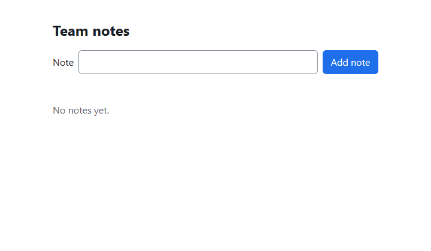

# okproof

**Your agent says it's done. okproof proves it, criterion by criterion.**

[](https://github.com/rudr19/okproof/actions/workflows/ci.yml)
[](https://github.com/rudr19/okproof/actions/workflows/codeql.yml)
[](https://scorecard.dev/viewer/?uri=github.com/rudr19/okproof)
[](https://www.npmjs.com/package/okproof)
[](LICENSE)

> Browser agents act. Test frameworks run. CI reports. **okproof proves.**
> [Why okproof](WHY.md) · [Project](#project) · [Contributing](CONTRIBUTING.md) · [Security](SECURITY.md)

"Proves" is the promise; here is exactly what is checked. okproof compares a
pull request with the acceptance criteria in its issue. The criteria go in a
proof file in the repo. Tests claim criteria by tag. The run ends with a ledger
that marks each criterion **met**, **failed**, **unproven** or **untested**. A
criterion is met only when a test tagged to it passed and made a real assertion.
Untested, flaky and assertion-less tests never count. If you run the optional
verifier, a bug it finds counts only when it reproduces on a model-free replay.
okproof does not judge whether a test is a *good* test, and ledgers are not
signed (see [Project](#project)).

okproof doesn't run your tests. It works with **Playwright Test** directly, and
with **any runner that writes JUnit XML**: Jest, Vitest, pytest, JUnit,
Cypress, Go and more. It has no runtime dependencies.

## Quick start (30 seconds)

```bash
npx okproof init --agents --workflow --runner playwright
```

That one command, in your repo:

- creates `.okproof/` with an example proof file (use `--issue 142 --title "Pro upgrade"` for a real one);
- writes `.github/workflows/okproof.yml`: it runs your tests with a JUnit reporter, then `rudr19/okproof@v0` ingests the results and gates the merge (`--runner` is one of `playwright`, `junit`, `ctrf`, `vitest`, `jest`, `pytest`);
- teaches coding agents the loop: it adds an okproof section to `AGENTS.md` and `CLAUDE.md`, copies the skill to `.claude/skills/okproof/SKILL.md`, and adds the okproof server to `.mcp.json` without touching your other servers.

Then edit the proof file, tag your tests with `[okproof:<id>]`, and push. The
pull request gets one okproof comment, and the check fails until every criterion
is met. `init` never overwrites a file; it prints what it skipped. Run it again
and nothing changes.

## How okproof thinks

okproof is an auditor that tries to **disprove** "done", not to confirm it.
"Done" stands only if the audit fails to knock it down. The principles (more in
[WHY.md](WHY.md)):

1. **The criterion is the unit, not the test.** Verdicts are per acceptance criterion.
2. **Silence counts against you.** Untested, flaky, assertion-less or untagged tests are not met.
3. **The auditor is never the author.** An independent verifier attacks; only model-free replay-confirmed bugs count.
4. **Graded evidence, not pass/fail.** Planned Evidence Levels: E0 claimed, E1 tagged test passed, E2 real relevant assertion, E3 survived adversarial attack (partly shipped), E4 verified in CI from the base branch with a signed ledger (roadmap, not built).
5. **Neutral across vendors.** It audits runs from any agent or runner through open JUnit and CTRF formats.

## Works with

Write JUnit XML (or CTRF JSON), then `npx okproof ingest <file>`.

| Runner | Reporter flag | Then |
| --- | --- | --- |
| Playwright | `npx playwright test --reporter=junit` (set `PLAYWRIGHT_JUNIT_OUTPUT_NAME=junit.xml`) | `npx okproof ingest junit.xml` |
| Vitest | `npx vitest run --reporter=junit --outputFile=junit.xml` | `npx okproof ingest junit.xml` |
| Jest | `npx jest --reporters=default --reporters=jest-junit` (needs `jest-junit`) | `npx okproof ingest junit.xml` |
| pytest | `python -m pytest --junitxml=junit.xml` | `npx okproof ingest junit.xml` |
| Cypress | `npx cypress run --reporter junit --reporter-options mochaFile=junit.xml` | `npx okproof ingest junit.xml` |
| Go | `gotestsum --junitfile junit.xml ./...` (needs gotestsum) | `npx okproof ingest junit.xml` |
| Anything with CTRF | a CTRF reporter writing `ctrf-report.json` | `npx okproof ingest ctrf-report.json` |

## Install

```bash
npm i -D okproof
npx okproof check
```

okproof has no runtime dependencies. The core (proof files, ledger, gate,
ingest, MCP server, Playwright reporter) runs on Node 20 or later. The browser
driver and the verifier use Node's built-in WebSocket and need Node 22 or later.

## See it in action

An agent says "All 5 acceptance criteria are implemented and tested. Done."
okproof checks the claim against the criteria in the issue:

```text
  Agent says: Done (5/5)
  okproof: 3 met · 1 failed · 1 untested — NOT PROVEN
```

Three criteria pass in a real browser. One fails, and a verifier refutation is
confirmed by replaying it with no model. One has no test at all. The gate exits
1. Run it yourself with `npm run demo` (no API key needed), or read
[the demo](examples/demo/README.md) and its
[ledger](examples/demo/out/ledger-101.md).

| Before reload | After reload |
| --- | --- |
|  |  |

## 1. Write a proof file

`.okproof/142.md`:

```md
## #142 Pro upgrade
- [ ] A member can upgrade the workspace to Pro from Billing
- [ ] Invoice preview shows a prorated amount before confirming
- [ ] A viewer (non-admin) cannot see the upgrade button
```

Run `npx okproof check` to print the tag for each criterion.

## 2. Claim criteria in test names

```ts
test('member upgrades to Pro [okproof:142.1] [okproof:142.2]', async ({ page }) => {
  // ...
});
```

Ids are positional by default. To keep a tag valid when criteria are reordered,
give a criterion a stable id with a `{#id}` prefix; see [docs/stable-ids.md](docs/stable-ids.md).

## 3. Build the ledger

**Playwright Test**: add the reporter.

```ts
// playwright.config.ts
export default defineConfig({
  reporter: [['list'], ['okproof/playwright']],
});
```

A test that passes only after a retry counts as flaky, which is not proven.
When Playwright records a trace, the ledger links it as evidence.

**Any other runner**: write JUnit XML, then ingest it.

```bash
npx vitest run --reporter=junit --outputFile=junit.xml
npx okproof ingest junit.xml
```

Or use CTRF (Common Test Report Format, ctrf.io). Many runners have a CTRF
reporter; ingest the JSON it writes. A test with `flaky: true` or retries that
passes is flaky, which is not proven.

```bash
npx okproof ingest ctrf-report.json
```

`ingest` picks the format from the file (`.json` is CTRF, otherwise JUnit XML).
Force it with `--format junit` or `--format ctrf`.

Both write `.okproof/ledger-<issue>.json` and `.md`. In GitHub Actions they also
write the ledger to the job summary and post it as one pull request comment
that reruns update. Give the job `pull-requests: write`, or pass
`{ github: false }` to turn this off.

## 4. Gate the merge

`npx okproof gate` exits 1 unless every criterion is met. Make it a required
check. The gate re-reads the proof files, so a stale ledger, a missing ledger or
stale verifier results fail it; the Action's `proven` output, the PR comment and
the MCP `okproof_status` verdict all use the same function.

A committed ledger is only a claim, so in CI gate from the job's own results:
`npx okproof gate --results junit.xml --require-issues 142,143` rebuilds the
ledgers in memory and ignores committed ones (the Action does this when its
`results` input is set). Do not commit `.okproof/ledger-*`. See
[docs/trust.md](docs/trust.md).

### Protect `.okproof/` with CODEOWNERS

Nothing in okproof stops an agent (or anyone with write access) from editing a
proof file to weaken a criterion. Make that a reviewed change: add a
`CODEOWNERS` entry for the folder and turn on required code-owner review.

```
# .github/CODEOWNERS
/.okproof/ @your-org/reviewers
```

Then in the repository settings (Branch protection or a ruleset for your
default branch) enable "Require a pull request before merging" and "Require
review from Code Owners", and make the okproof gate a required status check. A
pull request that touches `.okproof/*.md` now needs a human owner's approval, so
criteria cannot be silently removed or reworded by the author of the change.
Use a team or a person who is not the agent's account.

## Weak and unrelated tests

A tag is a claim; an assertion is evidence. A tagged test that passes but makes
zero assertions proves nothing, so okproof will not call its criterion met.
Silence is not proof.

A criterion gets one of four verdicts:

- `failed`: any claiming test failed, was flaky, skipped or timed out.
- `unproven` (shown as "UNPROVEN (no assertions)"): the claiming tests passed, but every one of them is weak. The ledger lists the weak test titles.
- `met`: all claiming tests passed and at least one made a real assertion.
- `untested`: no test claims it.

A test is weak when its assertion count is exactly `0`. An unknown count (the
runner did not say) is not weak, so runners without counts keep working. Pass
`--strict-assertions` (or set `OKPROOF_STRICT_ASSERTIONS=1`) to `okproof ingest`,
or `strictAssertions: true` to the reporter, to treat unknown as weak.

How each runner reports counts:

- **Playwright reporter**: counts `expect` steps in the result's step tree, nested ones and `expect.soft` included. A result with no step list is unknown.
- **JUnit**: the `assertions="N"` attribute on `<testcase>` (PHPUnit style). Absent means unknown. A testcase that passed only after a retry is `flaky`, so never met: `<flakyFailure>`/`<flakyError>` (Maven Surefire), `<rerunFailure>`/`<rerunError>`, or a `rerun`/`reruns`/`rerun_count` property that is not `0`.
- **CTRF**: `extra.assertions` on a test, when it is a number. Otherwise unknown.

A confirmed verifier refutation still makes a criterion `failed`.

### `okproof lint`

A static check that needs no test run:

```bash
npx okproof lint                       # scan the working directory
npx okproof lint --tests tests/ui      # limit to a path, file or glob such as "tests/**/*.spec.ts"
```

It finds tests whose title has `[okproof:<id>]` and reports the ones with no
assertion in the body (`expect(`, `assert`, `.should(`, `t.Error`, `t.Fatal`,
`require.`, `toBe`, `toEqual`, `toHave`, ...), or whose only assertions are
trivial: `expect(true).toBe(true)`, `expect(1).toBe(1)`, `expect(true).toBeTruthy()`,
`assert.ok(true)`, `assert.equal(1, 1)`, `assert True`, `assert 1 == 1`,
`self.assertTrue(True)` and the like. One real assertion next to a trivial one
is enough to pass this check. It also reports tags naming a
criterion that no proof file lists, and criteria no tagged test claims. It
exits 1 on a weak test or a dangling tag. Untested criteria are listed but do
not fail the run. Also available as `lintTests()` and the `okproof_lint` MCP tool.

It scans `*.test.*`, `*.spec.*`, `*.e2e.*`, `test_*.py`, `*_test.py` and
`*_test.go`, skipping `node_modules`, `dist` and `.git`, files over 1 MB and
anything past 5000 files. It is a heuristic with no parser: it follows
brackets while skipping strings, comments and regex literals (JS, TS, Go) or
reads the indented block (Python). Put the tag in the test title. A test
that only calls a helper which asserts is reported weak, and a tag in a comment
above a test is not followed. Treat a hit as a prompt to look, not a verdict.
The ledger counts from your runner are the authority.

Some runners report no assertion counts at all (JUnit from `node --test`, for
example), so a test with no assertion would be marked met. Feed lint into the
ledger to close that gap:

```bash
npx okproof ingest junit.xml --lint            # scan every test file under the working directory
npx okproof ingest junit.xml --lint tests/ui   # or a path or glob (`--lint=<path>` also works)
npx okproof gate --results junit.xml --lint
```

A test lint finds weak (no assertion, or only trivial ones) is counted as having
asserted nothing, so its criterion is `unproven`. Lint findings are matched to
results by the `[okproof:<id>]` tag plus the test title. A count your runner
does report stands, except for tests lint calls trivial. Relevance stays
advisory unless you add `--strict-relevance`. After a bare `--lint`, a
following word is read as the path; write `--lint=` to put the proof folder
after it. `gate --lint` needs `--results`.

#### Possibly unrelated tests

A tag is a claim, and an agent optimising for a green gate can tag a test that
checks something else. For every tagged test that does assert, lint compares the
claimed criterion with the test body and reports:

```
possibly unrelated: test 'login works' claims 5.1 ('A user can reset their password by email') but never mentions password, email, reset
```

This is advisory: it prints warnings and exits 0. Add `--strict-relevance`
(`strictRelevance: true` for `lintTests()` and the MCP tool) to make each one a
failure (exit 1).

How it works: the criterion is lowercased and split on non-letters, a small
built-in stopword list and words shorter than 3 characters are dropped (so are
"user"/"users", which start nearly every criterion), and simple stems are
compared (`s`, `es`, `ed`, `ing`). The test body contributes its identifiers,
split on camelCase and snake_case, and its string literals. The test's own title
and (in Python) function name do not count, because they are the easiest thing to
copy from the criterion. If **none** of the criterion's key words appear in the
body, the test is reported. One shared word is enough to stay quiet.

Known limits, so you can weigh a hit:

- **Synonyms are out of scope.** A test that calls `changePass()` for "reset the password" is reported (false positive).
- **Compound words** such as `signup` against "sign up" do not match.
- **Helpers hide intent.** A test that only calls `runScenario()` mentions nothing; the words live in the helper.
- **Page objects and fixtures** (`loginPage.submit()`) can carry the meaning outside the test body.
- **False negatives are easy.** A test can mention the right words and still check nothing relevant; one shared word passes, and a common word in the criterion (such as "list") matches almost anything.
- It checks wording, not behaviour. It cannot tell that a test is wrong, only that it never talks about the thing it claims.
- Code identifiers such as `expect`, `test`, `page` and `assert` are ignored as body words, but the same words in a string literal count.

Treat it as a prompt to open the test, not a verdict.

## Keep criteria in sync with the issue

The GitHub issue is the source of truth. Instead of copying its checkboxes by hand:

```sh
npx okproof sync --issue 142            # needs GITHUB_REPOSITORY (or --repo owner/name) and GITHUB_TOKEN/GH_TOKEN
npx okproof sync --issue 142 --body-file issue.md [--title "Pro upgrade"]   # offline
npx okproof sync --issue 142 --check    # CI: change nothing, exit 1 on drift
```

This writes `.okproof/142.md` (or the `[dir]` you pass; it must be inside the current directory). Rules:

- `- [ ]`, `- [x]` and `* [ ]` lines count; checkboxes inside fenced code blocks do not.
- If the issue has a heading named "Acceptance criteria" (any level), only the checkboxes under it count, up to the next heading of the same or higher level. Otherwise all checkboxes count.
- On an existing file, criteria already there keep their order and ids, new ones are appended, deleted ones are removed. Reordering in the issue alone is not drift.
- Ids are positional (`142.<n>`), so removing a middle criterion renumbers the later ones. okproof prints a warning listing `[okproof:142.3] -> [okproof:142.2]` so you can re-tag those tests.
- The file is rewritten from the issue, so hand-added notes in it are lost. An edited checkbox counts as one removed and one added.
- With `--body-file` the title comes from `--title`, else the first heading that is not "Acceptance criteria", else the file's current title.
- `--check` fails with "proof file is out of date with issue #n; run okproof sync".

In the Action, `sync: check` (the default) does this on every run. It uses the `issue` input, or else the issues the PR body closes ("Closes #N", "Fixes #N", "Resolves #N" in the same repo, ignoring code blocks and HTML comments) that already have a proof file in `dir`. `sync: write` only rewrites the files in the workspace; committing them is up to your workflow. `sync: off` skips it.

## GitHub Action

okproof ships as a composite action. Run your tests so they write JUnit XML, then
call it:

```yaml
name: okproof
on: pull_request

jobs:
  prove:
    runs-on: ubuntu-latest
    permissions:
      contents: read
      pull-requests: write # lets okproof post and update its one PR comment
    steps:
      - uses: actions/checkout@v4
      - uses: actions/setup-node@v4
        with:
          node-version: 22
      - run: npm ci
      - run: npx vitest run --reporter=junit --outputFile=junit.xml
      - id: okproof
        uses: rudr19/okproof@v0
        with:
          results: junit.xml
      - run: echo "proven=${{ steps.okproof.outputs.proven }}"
```

Inputs: `results` (JUnit XML path, optional), `dir` (default `.okproof`),
`gate` (default `true`, fail unless proven), `comment` (default `true`),
`issue` (issue number to sync from; default: detected from the PR body),
`sync` (`check` default, `write` or `off`), `lint` (`auto` default scans your test files and marks assertion-less tests weak; a path or glob limits the scan; `off` disables it), `node-version` (default `22`), `github-token` (default `${{ github.token }}`).
Outputs: `proven` (`true` or `false`) and `summary` (one line per proof file).
Set `comment: false` to skip the PR comment and job summary (for forks, or
when you only want the gate). The CLI honours the same switch as
`OKPROOF_NO_COMMENT=1`.

Releases are tagged `v0.x`, and a moving `v0` tag points at the latest one.
Pin `@v0` to follow it, or a full `v0.x.y` tag to hold still.

## Browser driver

okproof ships its own Chrome driver with zero runtime dependencies. It speaks the
DevTools Protocol directly over Node's built-in WebSocket (Node 22 or later) and
is built for agents: it returns short text snapshots of the accessibility tree
and acts by ref.

```ts
import { Browser } from 'okproof/driver';

const browser = await Browser.launch();
try {
  const page = await browser.newPage();
  await page.goto('https://example.com');
  const { text } = await page.snapshot(); // - link "More information..." [ref=e1]
  await page.click('e1');
  console.log(await page.title(), page.problems());
} finally {
  await browser.close();
}
```

Set `OKPROOF_CHROME` to use a specific Chrome, Chromium or Edge binary. Refs are
only valid until the next snapshot.

## Verifier

`okproof verify` points an adversarial QA agent at your running app (a preview
deployment, say) and tells it to prove each criterion **false**. It tries other
roles, bad and huge input, double submit, reload mid-flow, back, keyboard-only,
a 375px viewport and offline. It acts only through the driver above.

Models guess, so a claim is never trusted on its own. Every action is recorded
as plain JSON. A violation counts only if its assertion **fails again when the
recorded actions are replayed with no model**, in a fresh browser. Otherwise it
is listed as unconfirmed and does not fail the criterion.

```bash
export OKPROOF_ANTHROPIC_API_KEY=...        # explicit key, see below
npx okproof verify --url https://preview.example.com --issue 142
```

Options: `--dir .okproof`, `--max-steps 15`, `--model claude-opus-5-5`,
`--effort medium`. For an app behind a login use `--storage-state <file>`,
`--header 'Name: value'` or `--login <script.mjs>`; `--strict-detectors` turns off
per-detector attribution of findings (see [docs/trust.md](docs/trust.md)). It writes:

- `.okproof/verify-<issue>.json`: a verdict per criterion (`refuted`, `held` or
  `inconclusive`), findings, and the recorded actions
- `.okproof/repro/<criterion>.json`: a model-free regression script
- `.okproof/screenshots/`: a screenshot of each confirmed failure

`okproof ingest` then reads `verify-<issue>.json`: a criterion with a confirmed
refutation becomes **failed** with the evidence `refuted by verifier: <title>
(repro: .okproof/repro/<id>.json)`, whatever the tests said.

**Replay for free.** `okproof verify --replay-only [--url ...]` re-runs the saved
repro scripts with no model and no key. It exits 1 while a bug still
reproduces, so a fixed bug becomes a free regression check in CI.

**Deterministic detectors** run after every action, with no model: console
errors, uncaught exceptions, failed requests and HTTP 4xx/5xx, interactive
elements with no accessible name, horizontal overflow, and (opt in, same
origin, at most 20 links) broken links. They are confirmed the same way, by
reappearing on replay. A confirmed finding of severity 3 or more refutes the
criterion. Unnamed controls and overflow are severity 2: reported, not failing.

**Which account pays.** The Anthropic adapter needs an explicit key, either
`new AnthropicModel({ apiKey })` or `OKPROOF_ANTHROPIC_API_KEY`. It never falls
back to `ANTHROPIC_API_KEY`, auth tokens or CLI profiles, so you choose which
account pays. Without a key, `okproof verify` exits 2. `@anthropic-ai/sdk` is an
optional peer dependency (`>=1.0.0 <2.0.0`), loaded only when used: `npm i @anthropic-ai/sdk`. The
core stays dependency free, and any `ModelClient` works:

```ts
import { verify, AnthropicModel } from 'okproof/verify';
await verify({ baseUrl, model: new AnthropicModel({ apiKey }), dir: '.okproof' });
```

Status: the replay, detectors, agent loop and ledger integration are tested
against a scripted fake model. The Anthropic adapter is **not yet tested
against the live API**; its request and response shapes follow the SDK docs
and are checked against a fake client only. Known limits: broken-link checks
send no cookies; the key set is Enter, Tab, Escape, Backspace and arrows; one
tab, no file uploads or dialogs.

## Use with coding agents

`okproof mcp` runs an MCP server over stdio (no dependencies) so Claude Code,
Cursor and Codex can check the definition of done before they claim a task is
finished. For Claude Code, add this to `.mcp.json`:

```json
{ "mcpServers": { "okproof": { "command": "npx", "args": ["okproof", "mcp"] } } }
```

Tools (all take an optional `dir`, default `.okproof`, which must stay inside the
working directory):

- `okproof_criteria` lists criteria and the `[okproof:<issue>.<n>]` tag for each test title.
- `okproof_status` says "Done" or "Not done" and lists the unmet criteria. Call it before saying a task is finished.
- `okproof_ingest_junit` builds ledgers from a JUnit XML report.
- `okproof_lint` finds tagged tests with no assertion or only trivial ones, tests that never mention their criterion ("possibly unrelated", advisory; `strictRelevance` makes it fail), dangling tags and untested criteria. `okproof_status` reports criteria whose tests passed without asserting as unproven and names the tests.
- `okproof_add_criterion` appends a criterion. Through this server agents can add criteria but not remove or edit them; that limit covers the MCP tools only, not direct file edits (see CODEOWNERS below).

`skills/okproof/SKILL.md` is a Claude Code skill that tells agents to follow this
loop. `okproof init --agents` copies it to `.claude/skills/okproof/SKILL.md`.

`okproof init --agents` also appends this section (marked `<!-- okproof -->` so
it is added once) to `AGENTS.md` and `CLAUDE.md`. You can paste it by hand:

```md
<!-- okproof -->
## okproof: definition of done

This repo checks work against acceptance criteria in `.okproof/<issue>.md`.

1. Read `.okproof/<issue>.md` before you start. Each criterion has an id such as `142.1`.
2. Tag every test that covers a criterion with `[okproof:<id>]` in its title, for example
   `test('member can upgrade [okproof:142.1]', ...)`.
3. Run the tests, then `npx okproof ingest <results>` (JUnit XML or CTRF JSON) and
   `npx okproof gate` (or call the MCP tool `okproof_status`). Keep working until it says proven.
4. Never edit or remove existing criteria without telling the user exactly what you changed and why.
5. Add a real assertion to every tagged test. Untested, flaky and assertion-less tests never count.
```

An agent with file access can still edit `.okproof/*.md`. To stop that, protect
the folder with CODEOWNERS (for example `/.okproof/ @your-team`) and require
review, so criteria cannot change without a person approving.

## Project

**Status.** Shipped: proof files, ledger, merge gate, PR comment, Playwright
reporter, JUnit and CTRF ingest, weak-test check, `lint`, issue sync, MCP server,
`init`, own Chrome driver, and the verifier with model-free replay. The
verifier's Anthropic adapter is tested against a fake client only, not the live
API.

**Roadmap.** Ordered by priority; dates are intentions, not promises. Open an
issue to argue for a change.

- Next: more runner coverage and flaky detection in JUnit.
- Later, **not built yet**: **Revert check** (temporarily undo the PR's code
  change and re-run the tagged tests; if they still pass, the test doesn't cover
  the change), "Harden" (commit passing verifier runs as tests
  linked to criteria), **signed ledgers** (GitHub OIDC), a **hosted proof page**
  with history, and Firefox and WebKit in the driver.

**Non-goals.** Replacing your test runner or browser library, a browser-agent
platform, visual diffing, load testing, monitoring, and grading pull requests
with a model's opinion. See [WHY.md](WHY.md) for principles.

**Who decides.** The maintainer and project lead is Rudra Kumar Pandey
([@rudr19](https://github.com/rudr19)). Small changes: a pull request with
passing checks and maintainer approval. Larger changes (new commands, file
formats, anything touching the principles in [WHY.md](WHY.md)): open an issue
with a short proposal first and leave it open at least 5 days; the maintainer
decides if there is no agreement and writes down why. Committers may be added
later and are listed in [CODEOWNERS](.github/CODEOWNERS).

**Compatibility.** The proof file format and ledger JSON are public interfaces;
breaking them needs a major version and a migration note. Until 1.0, minor
versions may break APIs, and the [changelog](CHANGELOG.md) says how.

**Releases.** Cut from `main` by the release workflow only, each npm version
with a provenance attestation linking it to the commit and workflow run. Builds
from anywhere else are not official releases. See [RELEASING.md](RELEASING.md).

## License

Apache-2.0 for this package. Copyright © 2026 Rudra Kumar Pandey and
contributors. "okproof" is a trademark of its author; see
[TRADEMARK.md](TRADEMARK.md). Contributions are made under the
[CLA](CLA.md) and signed off under the DCO (see [CONTRIBUTING.md](CONTRIBUTING.md)).
