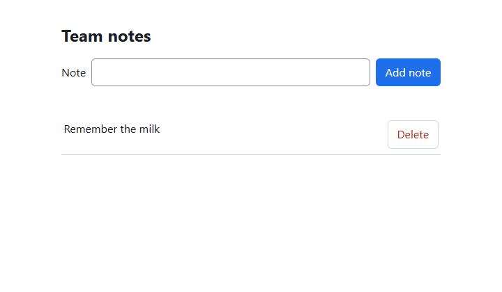
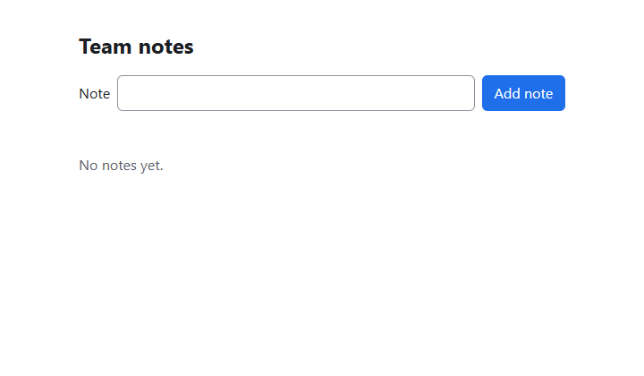

# Demo: an agent says "Done". okproof checks.

A coding agent finishes issue #101, "Team notes", and leaves this message
([AGENT_CLAIM.md](AGENT_CLAIM.md)):

> All 5 acceptance criteria are implemented and tested. Done.

The issue has five acceptance criteria ([.okproof/101.md](.okproof/101.md)). The app
([app/server.mjs](app/server.mjs), a dependency-free `node:http` server) has
one deliberate bug, notes are lost on reload, and one feature nobody built,
export. okproof runs the browser tests, reads the results and builds the ledger.

## Run it

```bash
npm install
npm run demo
```

You need Node 22 or later and Chrome, Chromium or Edge (set `OKPROOF_CHROME` if
okproof cannot find one). It takes about 15 seconds, calls no model API, reads no
credentials, and exits 0 whatever the ledger says.

What it does:

1. Starts the app on a free port.
2. Runs [tests/notes.test.mjs](tests/notes.test.mjs) with node's built-in test
   runner and its junit reporter, driving the app through okproof's own browser
   driver. Tests 101.1 to 101.3 pass. The test for 101.4 reloads the page and
   fails. No test claims 101.5.
3. Runs the verifier on criterion 101.4 with a `ScriptedModel`, a fixed script
   standing in for a model: it types a note, reloads and reports that the note
   is gone. The claim counts only because replaying the recorded actions in a
   fresh browser, with no model, fails the same assertion.
4. Runs `okproof ingest` (GitHub publishing off) and `okproof gate`.
5. Prints the summary below, and writes the ledger and two screenshots to
   `out/`.

## Expected output

From a real run:

```text
App: http://127.0.0.1:61978  (Team notes, issue #101)

1. Running the browser tests (node:test, junit reporter, okproof driver)...
   node --test exited 1 (101.4 is meant to fail); wrote examples/demo/out/junit.xml
2. Verifier on criterion 101.4 (ScriptedModel, no model API), then replay in a fresh browser...
   verdict: refuted; 1 finding(s) confirmed by replay; repro: examples/demo/out/.okproof/repro/101.4.json
3. okproof ingest, then okproof gate...
4. Screenshots...

================================================================
  Agent says: Done (5/5)
  okproof: 3 met · 1 failed · 1 untested — NOT PROVEN
================================================================
  met       101.1  A user can add a note and see it in the list
  met       101.2  Notes over 140 characters show an error and are not saved
  met       101.3  A user can delete a note
  FAILED    101.4  Notes are still there after a page reload
  untested  101.5  A user can export notes as a text file
================================================================
Verifier (scripted): 101.4 REFUTED, confirmed by replay in a fresh browser
  - Note is lost after a page reload
Gate: exit 1 (merge blocked)

Wrote examples/demo/out/ledger-101.md, examples/demo/out/before-reload.png, examples/demo/out/after-reload.png
```

The port and the timings in the ledger change from run to run. The counts do
not.

## The ledger

[out/ledger-101.md](out/ledger-101.md) is what okproof posts on the pull request:

| Criterion | Verdict | Evidence |
| --- | --- | --- |
| 101.1 A user can add a note and see it in the list | met | passed |
| 101.2 Notes over 140 characters show an error and are not saved | met | passed |
| 101.3 A user can delete a note | met | passed |
| 101.4 Notes are still there after a page reload | FAILED | failed; refuted by verifier |
| 101.5 A user can export notes as a text file | untested | none |

The untested criterion is the point: the agent said "implemented and tested",
but no test touches export, and okproof never counts untested as a pass.

## The screenshots

The same app, before and after a reload. The note is in the list, then it is
gone:

| Before reload | After reload |
| --- | --- |
|  |  |

## Files

- `app/server.mjs`: the app (`node app/server.mjs` serves it on port 3000).
- `.okproof/101.md`: the five criteria.
- `tests/notes.test.mjs`: the tests, tagged `[okproof:101.n]`. They skip when
  there is no Chrome.
- `run-demo.mjs`: the script behind `npm run demo`. Set `DEMO_OUT` to write
  somewhere other than `out/`.
- `out/`: everything the run writes. Only the ledger and the two screenshots
  are committed. The ledger's evidence for 101.4 names a repro script that
  lives in the ignored `out/.okproof/repro/`; run the demo to regenerate it.

## Limits

- The agent and the verifier are scripted. This shows how okproof treats a claim,
  not how well any model finds bugs. The Anthropic adapter is not used.
- The verifier's script knows where the bug is. What is real is the pipeline:
  the browser run, the replay without a model, the ledger and the gate.
